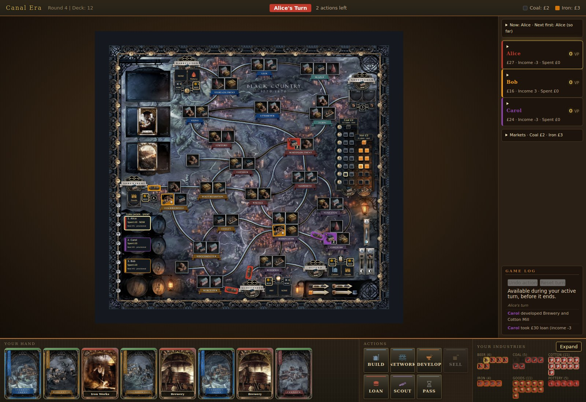

# Brass: Birmingham

[](https://github.com/aceszhenwei/brass-birmingham/actions/workflows/ci.yml)

An unofficial digital adaptation of the board game **Brass: Birmingham**, for
2–4 players in one browser (hotseat), with optional AI opponents. It runs
straight from `index.html`, with no build step and no dependencies.

> **Brass: Birmingham** is designed by Gavan Brown, Matt Tolman and Martin
> Wallace, and published by [Roxley Games](https://roxley.com/products/brass-birmingham).
> This is a fan project, not affiliated with or endorsed by them. Please
> support the original by buying the physical game.

<p align="center">
  
</p>

## Origins and credits

**The original digital implementation is by
[Nissan Pow (npow)](https://github.com/npow), in
[npow/brass-birmingham](https://github.com/npow/brass-birmingham).** That
project created the game you see here: the rules engine, the board, the
interface, the heuristic AI opponents, and the artwork integration. Upstream
contributors also include Reynold Chan (AI opponents and a graphics
overhaul), Jed Christiansen (a turn-order fix) and Alan Tao (cost
information). Upstream has its own
[documentation site](https://mintlify.com/npow/brass-birmingham).

**This repository is a fork** of upstream commit `2c1fe1f`. It keeps the
upstream game and adds:

- a rules audit against the official rulebook, and fixes for the defects it confirmed;
- the player choices the rulebook grants (which coal, iron, beer and merchant, and which tiles to sell for an income shortfall);
- an engine that runs the whole game itself, with seeded, reproducible randomness, cloning and save/restore support, and one legal-move API for the UI, the AI and tools;
- an automated test suite, headless simulations, and continuous integration.

Apart from those rules fixes and the choice dialogs, the gameplay,
presentation and AI strategy are upstream's. The fork's work is recorded in
the [history documents](docs/README.md#history).

Board geography and card data were referenced from community implementations,
and tile data was checked against the
[Tabletop Simulator implementation](https://github.com/ikegami/tts_brass) by
Kini / ikegami. The board, card, tile and player-mat artwork in `assets/` is
the publisher's copyright.

## Run it locally

Any static file server works:

```
python3 -m http.server 8080
```

Then open <http://localhost:8080>, choose 2–4 players, mark any AI seats, and
click **Begin Game**.

## Run the tests

You need Node.js 22 or later. Nothing to install:

```
node --test test/*.test.js             # the test suite, about 30 s
node scripts/simulate.js --games 10    # headless AI and random-move games
node scripts/check-repo.js             # index.html references and doc links
```

CI runs the same commands on every pull request; see
[`docs/testing.md`](docs/testing.md).

## What it does

- Both eras (Canal and Rail) for 2–4 players, with all seven actions: Build, Network, Develop, Sell, Loan, Scout and Pass.
- Automatic markets, income, turn order, era transitions and scoring.
- Choices wherever the rules give one, and legal sourcing otherwise.
- AI opponents at Easy, Normal and Hard.
- A guided turn workflow, explanations for disabled actions, a game log, and the bundled board art, with a procedural fallback board.

See [`docs/gameplay.md`](docs/gameplay.md) for how to play and the rules as
implemented.

<p align="center">
  
</p>

<p align="center">
  
</p>

## Known limitations

- Hotseat only, and hands are not hidden between human players.
- No save, load or undo in the interface, although the engine supports them.
- The Hard AI looks at opponents' hands.
- No software licence (see below).

The full list is in [`docs/known-limitations.md`](docs/known-limitations.md).

## Documentation

[`docs/`](docs/README.md) covers the architecture, the engine APIs, testing and
simulation, the board artwork, and the history of this fork.

## Licence

Neither this fork nor the upstream repository includes a software licence. The
code remains the copyright of its authors, and the artwork that of its
owners. Ask the upstream author before reusing or redistributing the code.
