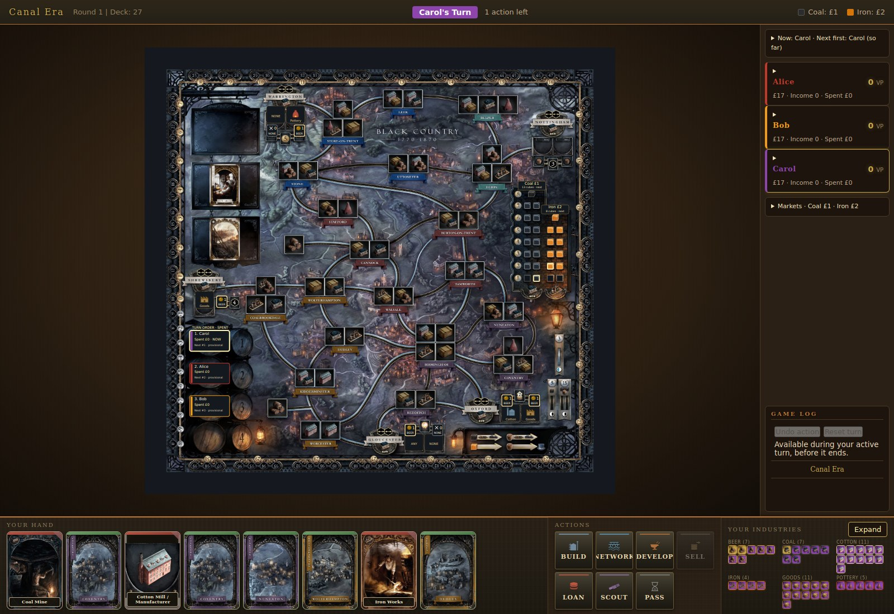
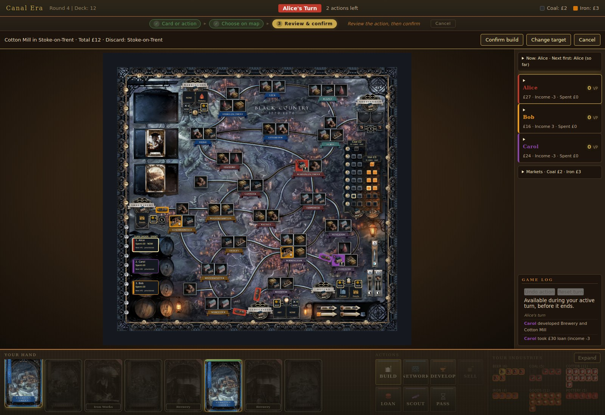
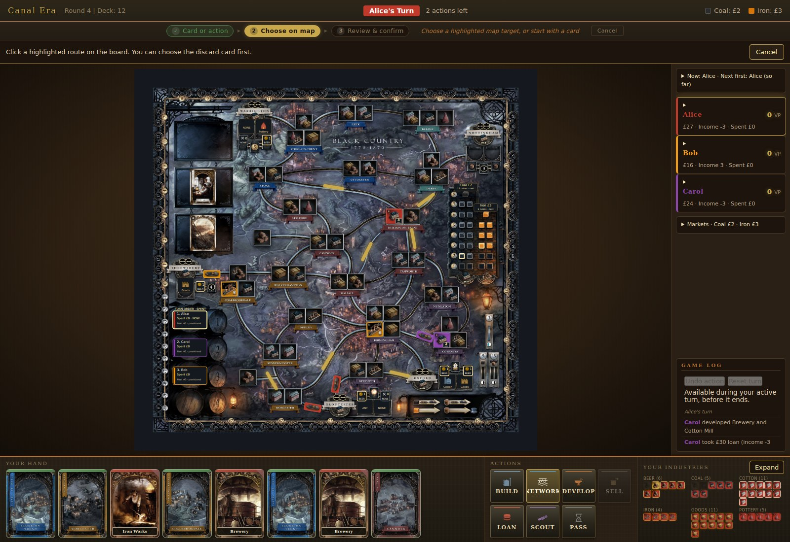
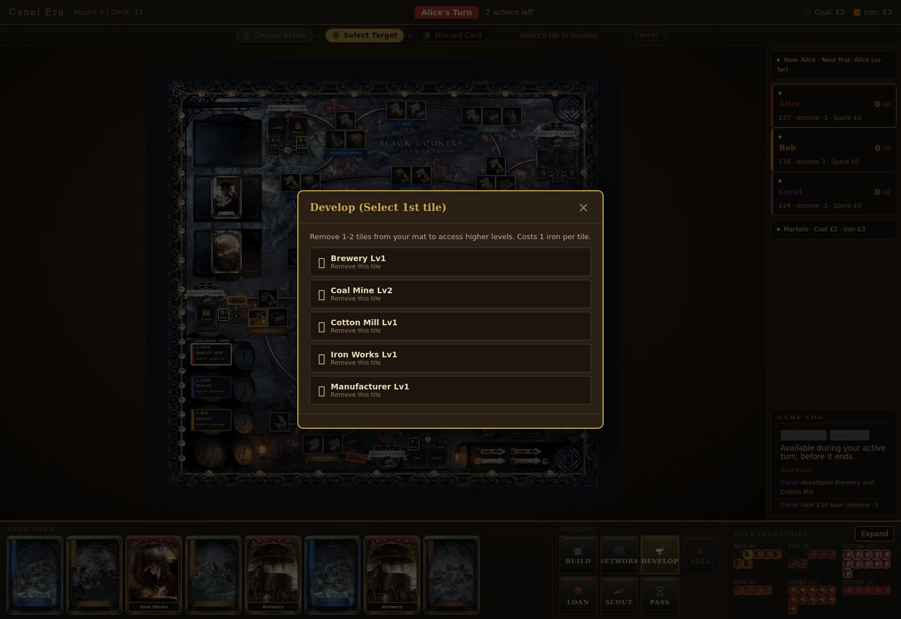
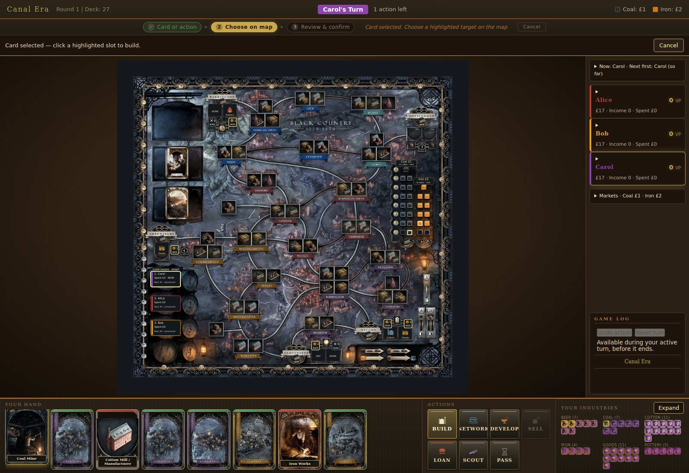
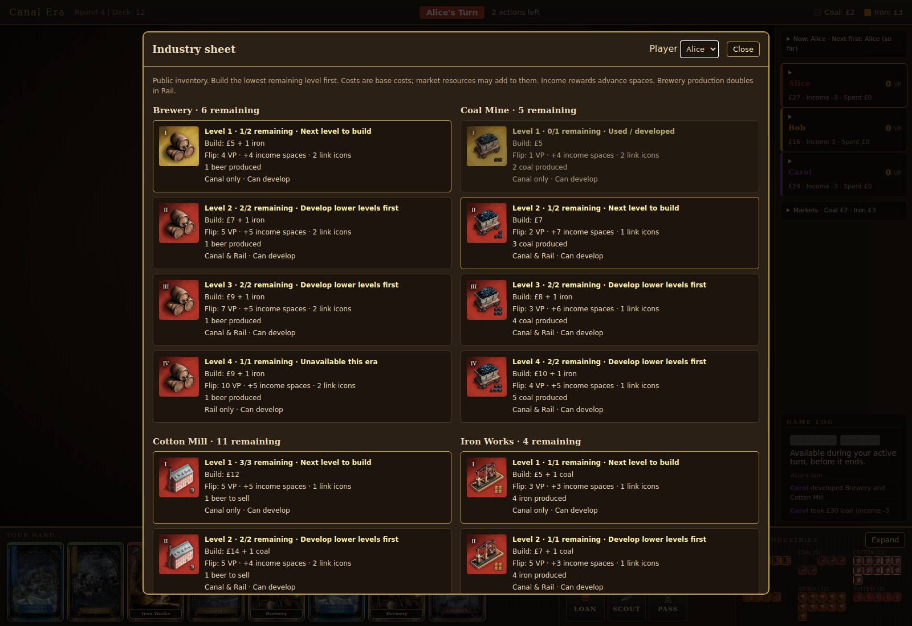
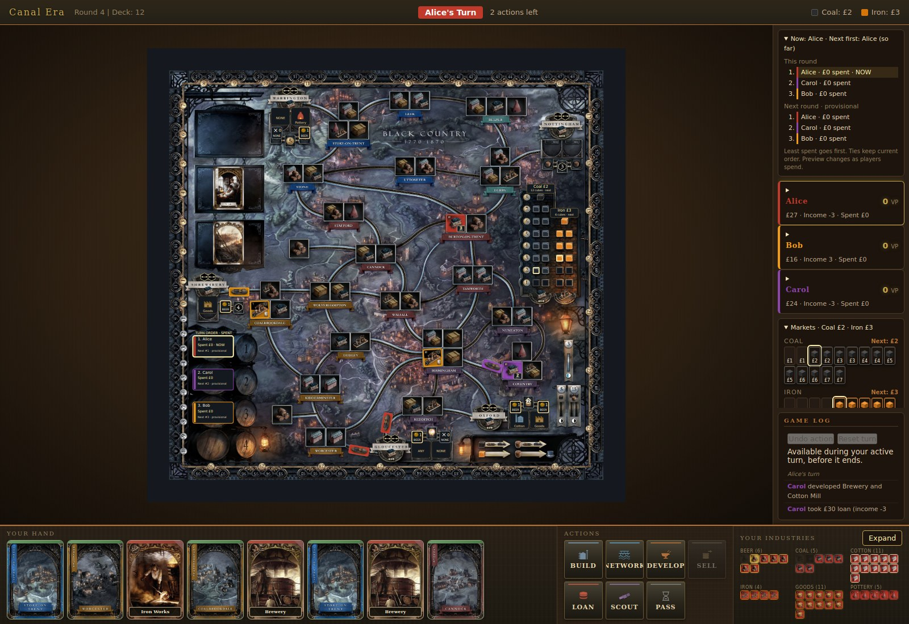

# Playing the Game

## Setup

1. Serve the folder and open it in a browser (see the [README](../README.md#run-it-locally)).
2. Choose 2–4 players, enter their names, and choose which seats are AI (Easy, Normal, or Hard).
3. Click **Begin Game**.

## The game in brief

You play rival entrepreneurs in Birmingham and the surrounding towns. You
build canals and railways, develop industries, and sell goods across two eras:

- **Canal Era.** You build canals and your first industries, with only one of your tiles per location. At the end of the era, canals and Level I tiles are removed, but Level II and higher tiles stay and score again.
- **Rail Era.** You build railways, which need coal, and may place several tiles per location.

| Industry | Role |
|---|---|
| Cotton Mills | Sell goods for VP; expensive but high-scoring |
| Coal Mines | Fuel rail links and industries; cheap, strong income |
| Iron Works | Supply iron for building and developing |
| Manufacturers | Eight levels with varied rewards |
| Potteries | Up to 20 VP; costly, needs planning |
| Breweries | Supply the beer needed to sell goods |

## On your turn

1. **Start with a card, a map target, or an action.** Clicking a card highlights the legal builds it permits. Clicking a map slot or route can start Build or Network directly. Develop, Sell, Loan, Scout, and Pass start from their action buttons.
2. **Follow the phase bar.** It shows your current step, what to do next, and a cancel button. **Escape** cancels at any time.
3. **Choose your target on the map** for Build or Network. If a slot supports several industries, choose from just those options. A second Rail link is selected on the map too; **Keep one link** skips it.
4. **Make any choices** the rules leave to you (which coal, iron, beer, or merchant) when there is more than one option.
5. **Choose a valid discard card** if you have not already selected one. Valid cards glow gold and invalid ones are dimmed.
6. **Review and confirm Build or Network.** The review bar shows the target, total cost including resource purchases, and discard card. Nothing is spent or discarded until confirmation. **Change target** keeps the selected card; **Cancel** clears the selection without changing the game. Other actions keep their existing discard flow.

The sidebar shows compact summaries by default. Click turn order or markets
to see their detailed lists, or a player to see cards and links remaining.
Expanded player details stay open across refreshes. The log retains its own
space. On coal and iron tiles, the live **N LEFT** badge replaces the printed
capacity symbols, so it indicates current supply rather than the initial
quantity. Flipped tiles retain their printed scoring information. The board
markets show occupied cubes and highlight the next purchase with its price.
Merchant demand stays visible after its beer is used; **1 BEER**, **0 USED**
and **0 NONE** distinguish available, consumed and blank merchant supplies.
The two wildcard stacks are supply artwork, not extra cards in your hand.

If you can't pay your income at the end of a round, you choose which of your
industry tiles to sell. Disabled action buttons have tooltips explaining why
they can't be used, for example "No iron available" or "Need at least 3
cards". Market prices, turn order, and scoring are handled for you.

*Build: select a card or map slot, choose any resource sources, then review and confirm while the board stays visible. A multi-industry slot opens only its local choices.*

*Network: click a highlighted route. In Rail, choose a second highlighted route or **Keep one link**, then review and confirm.*

*Sell: check the goods, the beer requirement, and the merchant bonus before selling.*

*Develop: spend iron to remove low-level tiles from your mat, optionally two at once.*

*Your hand, the seven actions, and your remaining industry tiles. Cards show the bundled printed faces, with SVG artwork as a fallback.*

## Industry inventory

Click **Expand** beside **Your Industries** to inspect the full inventory.
Choose any player to see public remaining counts, build costs, flip rewards,
production/beer requirements, development restrictions and era availability.
Costs here are base tile costs; the action review includes market purchases.
Close the dialog or press Escape to return to the current action.

## Undo and reset

**Undo action** restores the previous completed action in your active human
turn. **Reset turn** restores the start of that turn. Cards, resources,
spending, RNG state and log entries are restored together. To abandon an
unconfirmed selection, use **Cancel** or Escape instead.

The controls stop working when the turn ends, another player takes over, or
the round/era changes. They cannot undo a completed turn. In the one-action
first round, an executed action ends the turn immediately. They do not undo
AI turns or income-shortfall decisions.

## Game log and turn transitions

A scrollable game log in the right panel records every action, colour-coded by
player. Between turns, a short overlay shows the next player's name.

## Era scoring

At the end of each era, you score VP for your flipped industry tiles and for
the links connecting them. The review shows each player's Canal Industry, Canal Links and Total Canal,
then Rail Industry, Rail Links and Total Rail after Rail scoring. Canal
results stay visible in the Rail review, alongside cumulative VP.
Canal scoring appears before play resumes in Rail; Rail scoring appears
before the final ranking. Click **Continue** to advance. All-AI spectator
games automatically dismiss the review after a short pause.

## Rules as implemented

The engine follows the official rulebook. The points players most often ask about:

- **Coal** needs a connected source: a mine, or the market through a merchant link.
- **Iron** can come from any iron works on the board; no connection is needed.
- **Coal for a rail link** comes from the mine closest to either end of the new link. When mines are equally close, the player chooses.
- **Beer** for selling comes from your own breweries anywhere, from connected opponents' breweries, or from the barrel beside the merchant tile you sell to.
- **A sale is all or nothing.** If the selected tiles can't all be sold with the available beer, nothing is spent.
- **Overbuilding.** You may overbuild your own tiles with the same type at a higher level. You may overbuild an opponent's coal or iron tile only when that resource is exhausted everywhere.
- **Player choices.** You are asked whenever the rules allow a choice: equally close coal mines, any iron works, any eligible beer, which merchant tile, Gloucester's free develop, and which tiles to sell for an income shortfall. Otherwise sourcing is automatic.
- **Pottery I and III** have the lightbulb icon and can't be developed; they must be built.
- **Turn order** each round goes to whoever spent the least money; spending ties preserve the current order. The on-board and sidebar previews are provisional until the round ends.

Interpretations where the rulebook is not explicit are listed in
[`known-limitations.md`](known-limitations.md).

## Tips for new players

- **Build breweries early.** Beer is the most contested resource.
- **Watch the turn order.** Spending less money means going first next round.
- **Develop to skip weak tiles.** Level III and higher tiles are worth the iron.
- **Build Level II+ tiles in the Canal Era.** They stay and score in both eras.
- **Don't ignore income.** It compounds every round.
